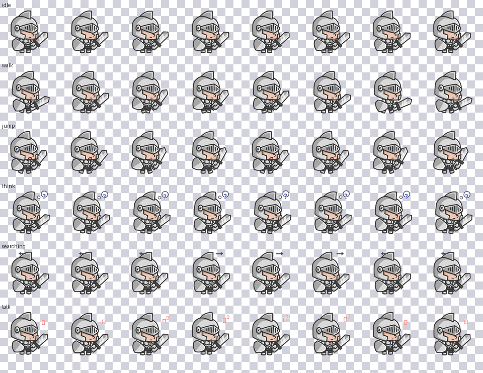

# 凌零 · 桌面 AI 数字员工

[](https://github.com/hm-yep/L-Agent/actions/workflows/tests.yml)

住在桌面上的 AI 数字员工：把一句话拆成计划、逐项执行本机与联网动作，交付可验收的成果（PPT / Word / Excel / 网页报告），并能把做过的改动撤销、把做过的流程存成技能重放。

仓库：github.com/hm-yep/L-Agent

## 能力 / 边界对照

下表的「主链路」指桌面对话链路（`framework/core.py`）；「旁路」指不经过该链路的独立入口。未列入主链路的能力，不写成桌面版已具备。

| 能力 | 真实状态 | 入口 / 边界 |
|---|---|---|
| 30 个动作（Function Calling 协议） | 桌面主链路 | `framework/action_parser.py` 的 `VALID_ACTIONS` 为动作全集 |
| 撤销账本（后悔药） | 桌面主链路 | `framework/effect_journal.py`：8 可逆 / 15 无副作用 / 1 撤销自身 / 6 明确不可逆 / 0 未分类，有单测钉死 |
| 技能层（save_skill / run_skill） | 桌面主链路 | `framework/skill_store.py`：只收 10 个确定性安全动作，重放零模型调用，有 import 拦截器证明 |
| Plan-and-Execute | 桌面主链路 | 15 轮预算 + 2 次重规划 |
| Quality Gate | 桌面主链路 | 识别「API 成功但结果不可用」，换词重搜 / 内容重写 / 降级 |
| GLM-4.6V 屏幕视觉 | 桌面主链路 | `see_screen`：截图 → 压缩 → 编码 → 注入上下文 |
| 文档工厂 | 桌面主链路 | PPT / Word / Excel / HTML |
| 多智能体 Planner→Executor→Reviewer | 仅 API | `framework/multi_agent.py` 只在 `/agent/run` 端点调用；`framework/core.py` 零引用 |
| RAG（LangChain + Chroma + BGE） | 仅 API | API 侧 `use_rag` 默认 False；桌面主链路不经过 |
| Whisper 语音 | 仅网页调试台 | `/voice`、`/voice/chat` 两个端点 |
| LoRA 微调 | 独立训练脚本 | `finetune/` 下 31 条样本的训练脚本，未接入产品推理链路 |

30 个动作按用途分 8 类（口径以 `VALID_ACTIONS` 为准，[产品功能介绍](产品功能介绍.md) 与本文一致）：桌面交互与动画、系统控制与电源、文档工厂、屏幕视觉、联网检索与本机阅读、数据分析、任务台 / 规划 / 记忆、撤销与技能。

## 5 分钟 Quick Start

### 安装

桌面核心（含 PyQt5 界面）：

```bash
pip install -r requirements.txt
```

只需要 API 服务时：

```bash
pip install -r requirements-api.txt
```

可选依赖按用途拆分：`requirements-rag.txt`（LangChain + Chroma + BGE）、`requirements-voice.txt`（Whisper）、`requirements-finetune.txt`（LoRA 训练）、`requirements-dev.txt`（开发 / 测试）。

### 无 Key 能看到什么

桌面版默认 `USE_REAL_AI=False`，不配 Key 走离线规则兜底。Windows / Linux 均直接启动：

```bash
python main.py
```

- 30 个动作里的工具意图（提醒、待办、文档、电源等）由离线规则引擎响应；
- 撤销（`undo_last`）与技能重放（`run_skill`）是纯本地代码路径，零模型调用，照样能用；
- 闲聊给兜底回复。

### 配 Key 后能看到什么

把 Key 写进环境变量 `DEEPSEEK_API_KEY`，或在启动后通过托盘 → 设置界面填写，才启用真实模型。两处都只写在本机，不进仓库。

```bash
# Windows (CMD)
set DEEPSEEK_API_KEY=你的Key
python main.py

# Linux / macOS
export DEEPSEEK_API_KEY=你的Key
python main.py
```

启用真实模型后：自然语言对话、Plan-and-Execute 规划、GLM-4.6V 屏幕视觉、联网检索、文档工厂生成带真实内容的成果。

单独启动 API 服务与网页调试台：

```bash
uvicorn api.server:app --host 127.0.0.1 --port 8000
```

浏览器打开 `http://127.0.0.1:8000/` 即为网页调试台；Windows 下也可双击 `启动助手.bat` / `启动API服务.bat`。API 相关环境变量：

- `LINGLING_API_TOKEN`：访问令牌，未配置时只接受本机回环请求；
- `LINGLING_API_ORIGINS`：CORS 白名单；
- `DEEPSEEK_API_KEY`：`/chat` 等端点调用真实模型时使用。

### 三个「为什么这样设计」

1. **撤销用世界快照求差集，而不是逐动作写 undo**：每轮开工拍一次可观测世界（音量 / 待办 / 提醒 / 交付 / 长期记忆），收口求差集，只按差集下逆操作，撤完再求一次差集自证。判据只有一份，动作实现改了什么这里就看见什么，不会漂移。详见 [ADR 0001](docs/adr/0001-undo-by-world-diff.md)。
2. **技能层只收确定性动作，重放零模型调用**：只把「参数完全由用户的话决定」的 10 个动作收进技能，拒收 `create_doc`，缺任一槽位整条拒跑。这样重放不依赖模型、不依赖网络，API 欠费时也能用。详见 [ADR 0002](docs/adr/0002-skill-replay-zero-llm.md)。
3. **主链路单一真源，旁路能力显式标边界**：桌面对话链路只认 `framework/core.py`；多智能体、RAG、Whisper、LoRA 各有独立入口，不塞进主链路，也不写成「桌面版已具备」。这么做是为了让「某个能力能不能在桌面上用」有唯一答案，而不是靠形容词描述。

完整架构图见 [docs/架构说明.md](docs/架构说明.md)，手动验收脚本见 [docs/QUICK_START.md](docs/QUICK_START.md)。

## 目录结构

```
framework/   Agent 主链路：动作解析、计划执行、质量门、效果记账、技能层、系统控制
             effect_journal.py   撤销账本（世界快照求差集）
             skill_store.py      技能层（零模型重放）
             action_registry.py  动作契约单一真源
             path_guard.py       本机文件读取白名单
api/         FastAPI 服务层 + 网页调试台（api/static/index.html）
             /agent/run 接 framework/multi_agent.py；/voice、/voice/chat 接 Whisper
ui/          PyQt5 桌面窗口、立绘与音效管理、计划卡片
assets/      立绘帧动画、音效、图标
tests/       pytest 单元测试
tools/       集成自检、契约检查、能力评测集与立绘处理工具
             test_agent_features.py  157 项集成自检
             check_contracts.py      CI 契约检查
             eval_tasks.py          端到端能力评测集
finetune/    LoRA 独立训练脚本（31 条样本），未接入产品推理链路
docs/        架构图、ADR、角色素材预览、上手手册与历史归档
data/        运行时产物（记忆、任务台、向量库、日志），已在 .gitignore 排除
```

## 测试与评测

三种口径分开看，不混称「测试套件」：

| 口径 | 命令 | 实测结果（2026-11-15） | 说明 |
|---|---|---|---|
| pytest 单测 | `pytest -q` | 200 passed / 1 skipped | 收集 `tests/` 下的单元测试（含 API 安全、路径白名单、契约、状态复位） |
| 契约检查 | `python tools/check_contracts.py` | 22/22 通过 | 校验动作契约、三套人设、依赖清单与 API 安全护栏 |
| tools 集成自检 | `python tools/test_agent_features.py` | 157 通过 / 0 失败 | 需单独运行的集成自检，证明技能/撤销零模型调用 |
| 能力评测集 | `python tools/eval_tasks.py` | 38/38 通过（100%） | 离线确定性任务的端到端通过率 + 失败原因分类 |
| 启动冒烟 | `python main.py --selftest` | 35/35 通过 | 离屏环境跳过 2 项依赖真实屏幕几何的布局断言；CI 自动运行 |

CI 依次执行：语法检查 → 契约检查 → pytest（带覆盖率）→ 启动冒烟 → 157 项集成自检 → 能力评测集。前四项共用同一套 `requirements-dev.txt` 安装路径，不再手工列包绕过依赖清单。

## 安全说明

- **Key 不入库**：`DEEPSEEK_API_KEY` 只从环境变量或设置界面读取，仓库内不含真实密钥；`data/` 为运行时产物，已被 `.gitignore` 排除。
- **API 鉴权**：访问令牌从 `LINGLING_API_TOKEN` 读取，未配置时只接受本机回环请求；CORS 白名单由 `LINGLING_API_ORIGINS` 配置。
- **文件路径白名单**：`framework/path_guard.py` 限制本机文件读取范围；上传文件名也会做路径归一校验。
- **日志脱敏**：运行日志不落明文密钥。
- **数据本地化**：对话记忆、任务台、交付登记均为本地 JSON 文件，不上传第三方。

## Docker

```bash
docker build -t lingling-api .
docker run -e DEEPSEEK_API_KEY=你的Key \
           -e LINGLING_API_TOKEN=换成一个随机串 \
           -p 8000:8000 lingling-api
```

镜像的启动命令是 `uvicorn api.server:app`，**只跑 API 服务**，不运行桌面 UI（PyQt5），基础依赖仅 `requirements-api.txt`。镜像监听 `0.0.0.0`，所以**必须**设置 `LINGLING_API_TOKEN`，调用时带 `X-API-Key: <token>`；未配置令牌时服务只接受回环请求，容器外访问返回 403。

可选能力用构建参数编入：`docker build --build-arg WITH_RAG=1 ...` 或 `WITH_VOICE=1`，两者都会显著增大镜像体积。

## 角色素材



骑士形象的立绘安装总览，属于角色素材，不是产品界面截图。其余预览图见 `docs/preview/`。

## License

[MIT](LICENSE)
