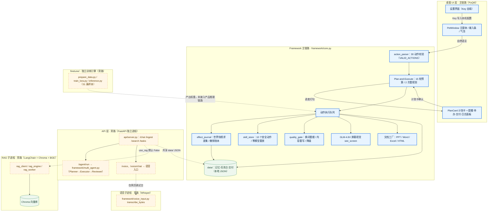

# 架构说明

本文是「凌零 · 桌面 AI 数字员工」当前架构的口径来源。图中实线箭头表示桌面对话主链路，虚线箭头表示旁路 / 独立引擎；蓝色节点为**主链路**，橙色虚线节点为**旁路或独立引擎**，绿色为**本地存储**。

## 完整架构图

图例：主链路 = 桌面 UI 层 ↔ `framework/core.py`；旁路 / 独立引擎 = API 层、RAG 子进程、语音子进程、`finetune/`。API 与桌面通过 `data/` 下的 JSON 共享记忆与任务台，但两者是独立进程，不共享内存状态。

## 能力边界

**主链路**（桌面对话，`framework/core.py`）：32 个动作、撤销账本（`framework/effect_journal.py`）、技能层（`framework/skill_store.py`）、Plan-and-Execute（15 轮预算 + 2 次重规划）、Quality Gate（换词重搜 / 内容重写 / 降级）、GLM-4.6V 屏幕视觉、文档工厂（PPT / Word / Excel / HTML）。这些能力在 README 的能力 / 边界对照表中标为「桌面主链路」。

**旁路 / 独立引擎**，不写成「桌面版已具备」：

| 模块 | 真实入口 | 边界 |
|---|---|---|
| 多智能体 Planner→Executor→Reviewer | 仅 API `/agent/run` | `framework/multi_agent.py` 只在该端点被调用，`framework/core.py` 零引用 |
| RAG（LangChain + Chroma + BGE） | 仅 API 侧，由 RAG 子进程承载 | `use_rag` 默认 False；桌面主链路不经过 |
| Whisper 语音 | 仅网页调试台 `/voice`、`/voice/chat` | 不在桌面主链路内 |
| LoRA 微调 | `finetune/` 独立训练脚本 | 31 条样本，产出权重未接入产品推理链路 |

**Docker**：镜像的启动命令是 `uvicorn api.server:app`，只跑 API 层，不启动桌面 UI 层。

**与旧图的关系**：[产品功能介绍.md](../产品功能介绍.md) 第六节那张 ASCII 示意图只画了 UI 层与 Framework 两层，缺少 API 层、RAG 子进程、语音子进程与 finetune 旁路，且框线不完整；本文的 Mermaid 图是当前的完整口径，以本文为准。

## 设计判断

- 撤销为什么用世界快照求差集：[ADR 0001](adr/0001-undo-by-world-diff.md)。
- 技能重放为什么必须零模型调用：[ADR 0002](adr/0002-skill-replay-zero-llm.md)。
- 手动验收步骤：[QUICK_START.md](QUICK_START.md)。
