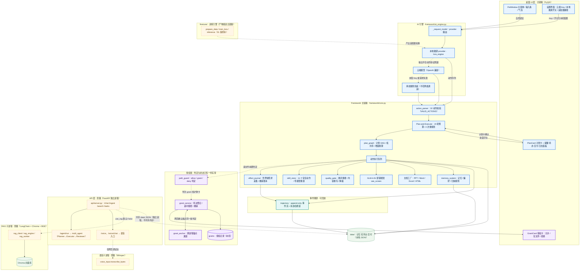

# 架构说明

本文是「凌零 · 桌面 AI 数字员工」当前架构的口径来源。

读图约定：

- **实线箭头** = 桌面对话主链路（一次用户输入到动作落地）；
- **虚线箭头** = 旁路、独立引擎，或「只在特定条件下才走」的分支；
- 蓝色 = 主链路，橙色虚线 = 旁路 / 独立引擎，紫色 = 授权链（安全边界），青色 = 事件溯源，绿色 = 本地存储。

图中每个节点都对应一个真实文件；写进图里而代码里没有的东西，一律不画。

## 完整架构图

图例补充：API 层与桌面层通过 `data/` 下的 JSON 共享记忆与任务台，但两者是**独立进程**，不共享内存状态；授权判定在两边走的是同一份实现（`path_guard` → `grant_service`），网页确认条只是另一个渲染入口。

## 三条横切关注点，为什么单独画

这张图把「安全」「可追溯」「能力路由」三件事从主链路里拉出来单独成组，因为它们各有一个只有这里有的事实：

**授权链（紫色）**：`path_guard` 只负责**判定**（allow / grant / deny），`grant_service` 负责记住「在等谁点头、等多久、答了算哪一档」。两者分开的原因是判定必须无状态、可单测，而等待必须有状态、可超时、可撤销。桌面浮层卡片与网页确认条是同一份状态的两个渲染——所以 `grant_anchor` 是跨进程通道，不是第二套判定。超时按**拒绝**处理，并把「这是超时按拒」记在请求上，不混同为用户拒绝。

**事件溯源（青色）**：`trajectory` 把一轮任务变成 append-only 事件流（`turn_start → action* → failure/quality/undo/preference/rule* → turn_end`），每个事件带状态哈希。这是撤销只能撤上一轮、失败不留证据、偏好无从归纳这三个老问题的共同解。

**provider 路由（AI 引擎组）**：`ai_engine._request_model` 里**本地微调 → 云端 → 离线规则**是三级降级，不是并列选项。本地这一档是「先答，合格才进队列」——吐残缺 JSON 或动作不在 32 个动作池里就退给云端，云端没 Key 再退离线规则。用户永远看不到半截 JSON。

## 能力边界

**主链路**（桌面对话，`framework/core.py`）：32 个动作、撤销账本（`framework/effect_journal.py`）、技能层（`framework/skill_store.py`）、Plan-and-Execute（15 轮预算 + 2 次重规划 + `framework/plan_graph.py` 的 DAG 校验与增量重算）、Quality Gate（换词重搜 / 内容重写 / 降级）、GLM-4.6V 屏幕视觉、文档工厂（PPT / Word / Excel / HTML）、授权链（`path_guard` / `grant_service` / `grant_anchor`）、事件溯源（`framework/trajectory.py`）、记忆与偏好（`framework/memory_system.py`）、**本地微调模型 provider**（`framework/lora_engine.py`，可选）。这些能力在 README 的能力 / 边界对照表中标为「桌面主链路」。

**主链路里的 provider，不是旁路**：本地微调模型（LoRA）由 `framework/ai_engine.py` 的 `_request_model` 路由，顺序是**本地微调 → 云端模型 → 离线规则兜底**。它的边界写在明处：只吃当前这一句用户输入（长期记忆 / 检索资料 / 人设提示词不进本地模型）；吐了残缺 JSON 或动作不在动作池里就退给云端；缺依赖 / 缺权重 / 加载失败如实降级。训练与推理共用 `framework/lora_format.py` 的提示词模板。实测口径见 [ADR 0010](adr/0010-lora-as-main-chain-provider.md)。

**旁路 / 独立引擎**，不写成「桌面版已具备」：

| 模块 | 真实入口 | 边界 |
|---|---|---|
| 多智能体 Planner→Executor→Reviewer | 仅 API `/agent/run` | `framework/multi_agent.py` 只在该端点被调用，`framework/core.py` 零引用 |
| RAG（LangChain + Chroma + BGE） | 仅 API 侧，由 RAG 子进程承载 | `use_rag` 默认 False；桌面主链路不经过 |
| Whisper 语音 | 仅网页调试台 `/voice`、`/voice/chat` | 不在桌面主链路内 |
| 偏好归纳与扰动评测 | 离线工具（`framework/preference.py`、`framework/evolution.py`、`tools/benchmark.py`） | 跑的是离线确定性链路，不等同于联网或真实大模型表现 |

**Docker**：镜像的启动命令是 `uvicorn api.server:app`，只跑 API 层，不启动桌面 UI 层。

**与旧图的关系**：[产品功能介绍.md](../产品功能介绍.md) 第六节那张 ASCII 示意图只画了 UI 层与 Framework 两层，缺少 API 层、RAG 子进程、语音子进程、finetune 训练引擎与授权链；本文的 Mermaid 图是当前的完整口径，以本文为准。`finetune/` 三个脚本已与主链路对齐（提示词模板统一到 `lora_format`），不再是「历史文档」。

## 设计判断

- 撤销为什么用世界快照求差集：[ADR 0001](adr/0001-undo-by-world-diff.md)。
- 技能重放为什么必须零模型调用：[ADR 0002](adr/0002-skill-replay-zero-llm.md)。
- 本地微调为什么是 provider 而不是旁路：[ADR 0010](adr/0010-lora-as-main-chain-provider.md)。
- 手动验收步骤：[QUICK_START.md](QUICK_START.md)。
